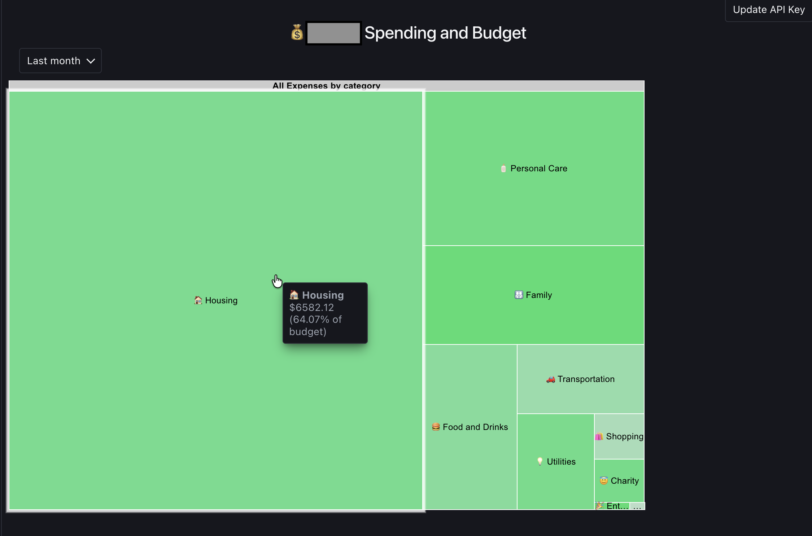

# Lunch Bites

[Lunch Money](https://lunchmoney.app/) is a personal finance and budgeting website which organizes expenses into hierarchical [categories](https://lunchmoney.app/features/categories-tags) and associates [budgets](https://lunchmoney.app/features/budgeting/) with them. These are experimental utilities using the [Lunch Money API](https://lunchmoney.dev/v2/docs). 

## Tree map of expenses



A [Tree map](https://en.wikipedia.org/wiki/Treemapping) helps to visualize the amount spent in each category as rectangles whose areas are in proportion to the total. It has the following features:

- color of a rectangle is based on the portion of the budget spent in that category,
- drill down and roll up the category hierarchy,
- show the transactions that went into each category or its sub-categories

This can be viewed for the current and last month.

## Getting started

[Install Node.js](https://nodejs.org/en/download) and clone this repo. Then run locally using `npm run dev`. A [Lunch Money access token](https://my.lunchmoney.app/developers) is required. NOTE: The access token remains local to the user's browser and is sent only to Lunch Money API.

That's it for now! Stay tuned for other utilities.

## Adding a capability

All pages provide only a minimal HTML document with an `#application-root`. The shared layout in `src/app-shell.html` supplies the navigation, API-key dialog, and content area, so the sidebar is maintained in one place. The links and home-page cards are both generated from `src/capability-catalog.ts`.

A capability page provides a `Capability` from `src/capability.ts`, supplying its markup and initializer. The application injects that markup into the shared content area and invokes the initializer with the authenticated API context.

For example, a capability module can import its HTML fragment with Vite's `?raw` suffix and provide both pieces:

```ts
import { startApplication } from './main';
import type { CapabilityContext } from './capability';
import pageHtml from './pages/example.html?raw';

function initialize(context: CapabilityContext) {
  // Set up the capability using the shared authenticated API context.
}

startApplication(pageHtml, initialize);
```

Use a page-specific module as the page's script entry. Add a link and description to `src/capability-catalog.ts`; that single entry updates both the sidebar and home-page cards. Each top-level HTML page is included in the production build automatically. Pages without a capability can start the shared shell through `/src/app.ts` or provide page-specific HTML through `startApplication(pageHtml)`.
